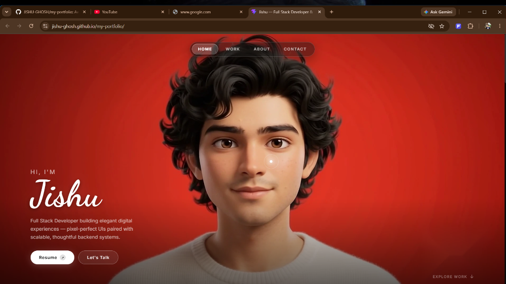
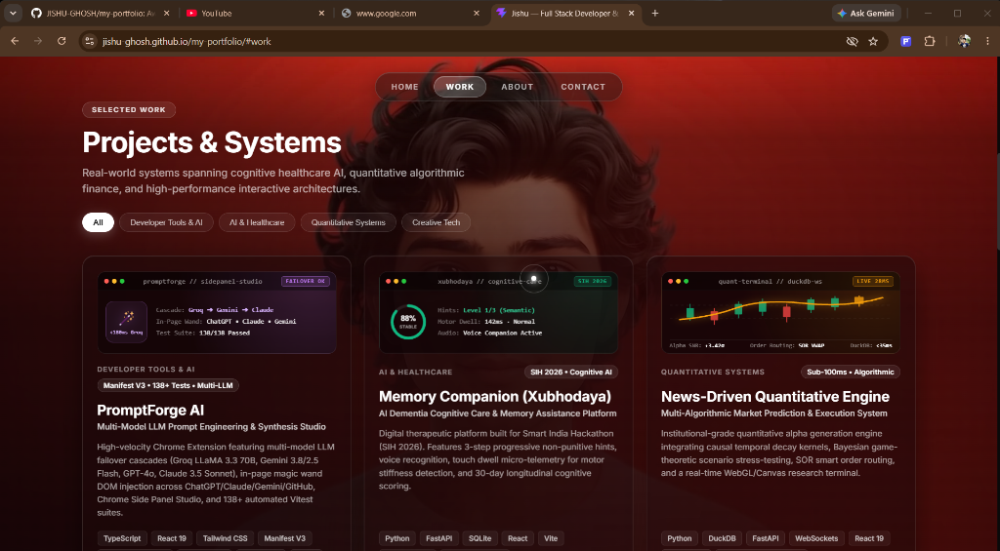
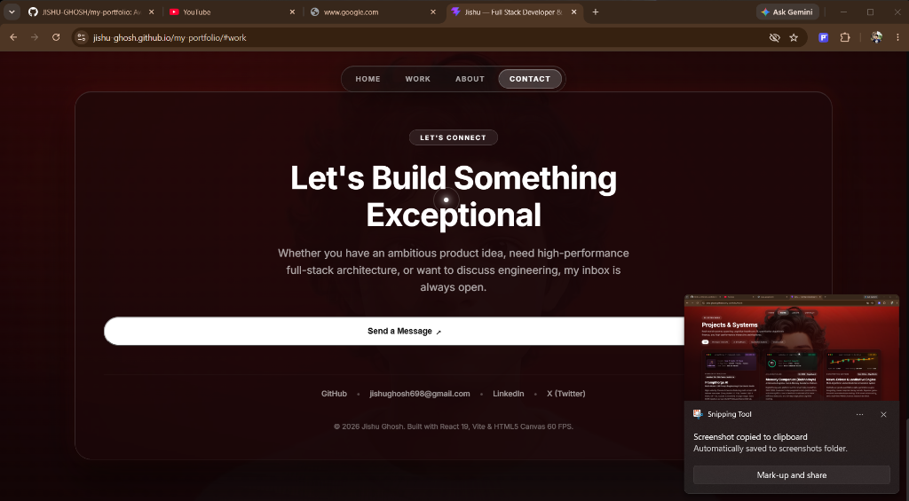

# Jishu Ghosh — Developer Portfolio Showcase

Visual showcase and architecture overview of the personal portfolio website for **Jishu Ghosh**, Full Stack Developer & AI Engineer.

🌐 **Live Website:** [jishu-ghosh.github.io/my-portfolio](https://jishu-ghosh.github.io/my-portfolio/)  
💻 **Source Repository:** [JISHU-GHOSH/my-portfolio](https://github.com/JISHU-GHOSH/my-portfolio)

---

## 📸 Visual Previews

### 1. Hero Section & Interactive Character Tracking
An award-winning, interactive hero section featuring a 60 FPS zero-ghosting, zero-lag character animation that tracks user cursor movements with real-time rotational physics and direct eye contact.

* **Key Highlights:**
  * 60 FPS HTML5 Canvas renderer with pre-rendered WebP frames.
  * Shortest-path circular angular lerp for fluid cursor following.
  * Direct eye-contact deadzone when hovering near the center.
  * Custom magnetic spring cursor with dynamic trailing ring.

---

### 2. Selected Work — Projects & Systems
Showcase of real-world systems spanning cognitive healthcare AI, quantitative algorithmic finance, and high-performance interactive architectures.

* **Featured Systems:**
  * **PromptForge AI:** High-velocity Chrome Extension featuring multi-model LLM failover cascades (Groq, Gemini, Claude, GPT-4o), in-page magic wand DOM injection, and 138+ automated test suites *(TypeScript, React 19, Tailwind CSS, Manifest V3)*.
  * **Memory Companion (Xubhodaya):** Digital therapeutic platform for dementia cognitive care & memory assistance built for Smart India Hackathon (SIH 2026) *(Python, FastAPI, SQLite, React, Vite)*.
  * **News-Driven Quantitative Engine:** Institutional-grade quantitative alpha generation engine with real-time WebGL/Canvas research terminal *(Python, DuckDB, FastAPI, WebSockets, React 19)*.

---

### 3. Contact & Collaboration
Seamless call-to-action with interactive modal messaging and direct links to GitHub, LinkedIn, and social profiles.

---

## 🛠️ Technology Stack

* **Frontend:** React 19, Vite, Tailwind CSS, HTML5 Canvas (60 FPS)
* **Design & Physics:** Custom Spring Dynamics, OpenCV Inpainting, Frosted Glass Glassmorphism
* **Backend & Systems:** Python, FastAPI, DuckDB, SQLite, WebSockets
* **Deployment:** GitHub Pages / Vercel

---

## 👤 Author

**Jishu Ghosh**
* GitHub: [@JISHU-GHOSH](https://github.com/JISHU-GHOSH)
* Email: [jishughosh698@gmail.com](mailto:jishughosh698@gmail.com)
